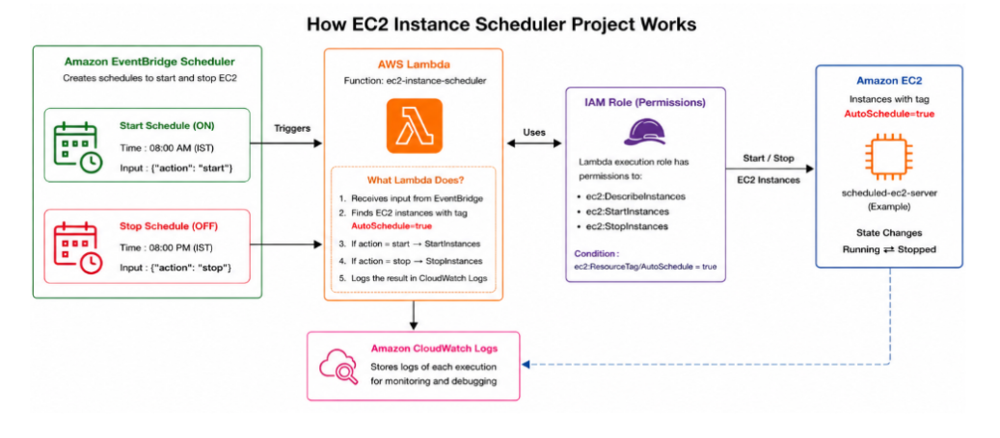
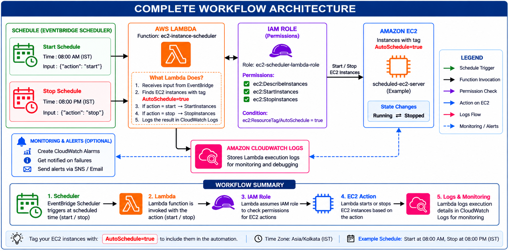

# AWS EC2 Instance Scheduler 🚀

### Automated EC2 Start/Stop Using AWS Lambda and Amazon EventBridge Scheduler


## 📌 Project Overview

The **AWS EC2 Instance Scheduler** is a cloud automation project that automatically starts and stops Amazon EC2 instances at scheduled times using AWS Lambda and Amazon EventBridge Scheduler.

The Lambda function identifies EC2 instances using the `AutoSchedule=true` tag and performs the requested action based on the event received from EventBridge.

This project demonstrates AWS automation, serverless computing, IAM permissions, monitoring, and cloud cost optimization.

## 🏗️ Architecture Diagram



### How It Works

1. EventBridge Scheduler triggers the Lambda function at the configured time.
2. Lambda receives an action: `start` or `stop`.
3. Lambda searches for EC2 instances tagged `AutoSchedule=true`.
4. The Lambda execution role provides the required EC2 permissions.
5. Lambda starts or stops the selected instances.
6. Execution logs are available in Amazon CloudWatch Logs.

## 🛠️ AWS Services Used

| AWS Service | Purpose |
|---|---|
| Amazon EC2 | Compute instances managed by the scheduler |
| AWS Lambda | Executes the automation using Python and Boto3 |
| Amazon EventBridge Scheduler | Triggers Lambda on a schedule |
| AWS IAM | Controls permissions for EC2 operations |
| Amazon CloudWatch Logs | Records Lambda execution logs |

## 📂 Repository Structure

```text
aws-ec2-instance-scheduler/
│
├── README.md
│
├── lambda/
│   └── ec2_instance_scheduler.py
│
├── iam/
│   └── ec2-instance-scheduler-policy.json
│
├── architecture/
│   └── ec2-scheduler-architecture.png
│
├── screenshots/
│   ├── 01-ec2-instance.png
│   ├── 02-autoschedule-tag.png
│   ├── 03-lambda-function.png
│   ├── 04-iam-policy.png
│   ├── 05-start-schedule.png
│   ├── 06-stop-schedule.png
│   ├── 07-start-test.png
│   ├── 08-stop-test.png
│   └── 09-cloudwatch-logs.png
│
└── docs/
    └── project-documentation.pdf
```

## ⚙️ Project Configuration

### 1. EC2 Instance

Example instance name:

`scheduled-ec2-server`

Add the following tag to the EC2 instance:

| Key | Value |
|---|---|
| `AutoSchedule` | `true` |

The Lambda function uses this tag to identify the instances intended for automation.

### 2. Lambda Function

Function name:

`ec2-instance-scheduler`

Runtime: Python (use the runtime configured in your AWS account).

The function uses Boto3 to discover tagged instances and call the EC2 start or stop API.

### 3. IAM Role and Policy

Execution role:

`ec2-scheduler-lambda-role`

Policy name:

`EC2InstanceSchedulerPolicy`

Required EC2 permissions:

- `ec2:DescribeInstances`
- `ec2:StartInstances`
- `ec2:StopInstances`

The start/stop actions are restricted using the `AutoSchedule=true` resource-tag condition. The Lambda role also needs permission to write logs to CloudWatch.

### 4. EventBridge Schedules

**Start schedule:** `ec2-start-schedule`

Input:

```json
{
  "action": "start"
}
```

**Stop schedule:** `ec2-stop-schedule`

Input:

```json
{
  "action": "stop"
}
```

Configure the desired times and the `Asia/Kolkata` timezone if you want the schedules to run on Indian Standard Time.

## Complete Workflow Architecture




## 🧪 Testing and Results

The project was tested with both actions.

### Test 1: Start EC2

- Initial state: Stopped
- Event input: `{"action":"start"}`
- Expected result: Running

### Test 2: Stop EC2

- Initial state: Running
- Event input: `{"action":"stop"}`
- Expected result: Stopped

CloudWatch Logs can be used to review Lambda executions and troubleshoot errors.

Actual test screenshots are provided in the `screenshots/` directory.

## 📸 Project Screenshots

### EC2 Instance


### AutoSchedule Tag


### Lambda Function


### EventBridge Schedules


### Testing and Monitoring


## 💰 Cost Optimization

Automating EC2 shutdown during unused periods can reduce compute costs.

Keep in mind that stopped EC2 instances may still incur charges for EBS volumes, Elastic IPs in some configurations, and other associated resources.

After testing, unnecessary resources can be stopped or deleted to help control AWS costs.

## 🎯 Key Learnings

- EC2 lifecycle management
- Python and Boto3 automation
- AWS Lambda functions
- EventBridge scheduled triggers
- IAM roles and resource-tag conditions
- CloudWatch Logs and troubleshooting
- Cloud cost optimization

## 🚀 Future Improvements

- Add structured logging and improved error handling.
- Handle pagination in EC2 instance discovery.
- Add CloudWatch alarms and SNS notifications.
- Support configurable schedules for multiple environments.
- Automate infrastructure deployment using Terraform.

## 👨‍💻 Author

Created as a hands-on AWS learning project focused on cloud automation, serverless computing, IAM, monitoring, and cost optimization.

**Project:** AWS EC2 Instance Scheduler
